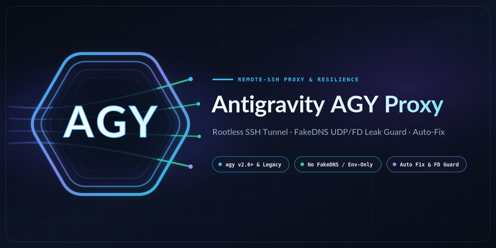

# Antigravity AGY Proxy

  
  
  
  

  <strong>Zero-leak Remote-SSH proxy, keepalive, and auto-healing toolkit for Antigravity IDE (v2.6.0+ <code>agy</code> &amp; legacy servers).</strong> 
  面向 <strong>Antigravity IDE Remote-SSH</strong> 的高稳定性代理与自愈扩展：兼容 v2.6.0+ <code>agy</code> 与旧版服务端，彻底解决 FakeDNS UDP 句柄泄漏、SSH 假死断连与 DNS 污染问题。

---

## Install · 立即安装

| Platform / 平台 | Link / 安装入口 |
|---|---|
| **Project Website / 官网介绍** | [**emorzz1g.github.io/antigravity-agy-proxy**](https://emorzz1g.github.io/antigravity-agy-proxy/) |
| **Open VSX Registry** *(Recommended for Antigravity IDE)* | [**Install from Open VSX**](https://open-vsx.org/extension/EmorZz1G/antigravity-agy-proxy) |
| **VS Code Marketplace** | [**Install from VS Code Marketplace**](https://marketplace.visualstudio.com/items?itemName=EmorZz1G.antigravity-agy-proxy) |
| **GitHub Releases (`.vsix`)** | [**Download Latest Release**](https://github.com/EmorZz1G/antigravity-agy-proxy/releases) |

---

## Why Antigravity AGY Proxy? · 核心亮点

- **v2.6.0+ `agy` & Legacy Compatibility / 全面兼容新旧后端**
  Automatically wraps `~/.gemini/bin/agy` (`agy --hub`, atomic `agy.bak` backup, fast `--version` bypass) as well as legacy `language_server_linux_x64` / `arm64`, with seamless migration from `dinobot22/antigravity-ssh-proxy`.
- **Zero FakeDNS UDP/FD Leaks / 消除 FakeDNS 句柄泄漏**
  Defaults to `mgraftcp-no-fakedns` (`--disable-fakedns`), keeping transparent TCP interception without leaking UDP `:0` ephemeral ports that crash remote SSH hosts. Also supports `env-only` and `mgraftcp-fakedns`.
- **Full Protocols & DNS Resilience / 全协议与防 DNS 污染**
  Supports `http` (Clash / V2Ray / Mihomo), `socks5`, and `socks5h` (remote DNS resolution via proxy without FakeDNS overhead).
- **SSH Keepalive & Rootless FD Guard / SSH 保活与无 Root 守护**
  Manages `~/.ssh/config.antigravity` (`RemoteForward` + `ServerAliveInterval 30` / `ServerAliveCountMax 3`) and an optional rootless `crontab` FD Guard.
- **9-Point Diagnostics & One-Click Auto Fix / 9 项全链路诊断与一键排错**
  Real-time checks across local proxy, SSH tunnel, wrapper sync, orphan `PPID=1` processes, `/proc/<pid>/fd` & UDP health, DNS resolution, and parallel protocol probes—with automated remediation.

---

## 3-Step Quick Start · 三步快速上手

1. **Start Local Proxy & Open Local Window / 启动本地代理并先开本地窗口**
   Run Clash / V2Ray / Mihomo locally (default port `7890`), open a **local** Antigravity IDE window first, and wait until the bottom-left `AGY Proxy` indicator turns green (auto-writes `~/.ssh/config.antigravity`).
2. **Connect Remote Host in a New Window / 新窗口连接远程服务器**
   Connect via Remote-SSH using **`Connect SSH Host in New Window`**. The extension automatically wraps remote `agy` / `language_server_linux_*` binaries.
3. **Manage & Troubleshoot / 状态面板与一键排错**
   Click **`AGY Proxy`** in the status bar to switch protocols (`http` / `socks5` / `socks5h`) or modes, toggle FD Guard, monitor traffic, run 9-point diagnostics, or trigger **Auto Fix**.

---

## Documentation Index · 详细技术文档索引

All in-depth technical documentation is maintained in [`docs/`](https://github.com/EmorZz1G/antigravity-agy-proxy/tree/main/docs):

| Topic / 主题 | English | 简体中文 |
|---|---|---|
| **Architecture & Proxy Modes** *(SSH tunnel, `agy` wrapping, 3 modes, FD Guard)* | [architecture-and-modes.md](https://github.com/EmorZz1G/antigravity-agy-proxy/blob/main/docs/architecture-and-modes.md) | [architecture-and-modes.zh-CN.md](https://github.com/EmorZz1G/antigravity-agy-proxy/blob/main/docs/architecture-and-modes.zh-CN.md) |
| **Configuration & Commands** *(All settings & command palette actions)* | [configuration-and-commands.md](https://github.com/EmorZz1G/antigravity-agy-proxy/blob/main/docs/configuration-and-commands.md) | [configuration-and-commands.zh-CN.md](https://github.com/EmorZz1G/antigravity-agy-proxy/blob/main/docs/configuration-and-commands.zh-CN.md) |
| **Diagnostics & Auto Fix** *(9-point checks & automated remediation)* | [diagnostics-and-autofix.md](https://github.com/EmorZz1G/antigravity-agy-proxy/blob/main/docs/diagnostics-and-autofix.md) | [diagnostics-and-autofix.zh-CN.md](https://github.com/EmorZz1G/antigravity-agy-proxy/blob/main/docs/diagnostics-and-autofix.zh-CN.md) |
| **Troubleshooting & Issue Guide** *(DNS pollution, Docker `ptrace`, bug report checklist)* | [troubleshooting.md](https://github.com/EmorZz1G/antigravity-agy-proxy/blob/main/docs/troubleshooting.md) | [troubleshooting.zh-CN.md](https://github.com/EmorZz1G/antigravity-agy-proxy/blob/main/docs/troubleshooting.zh-CN.md) |
| **Changelog / 更新日志** | [CHANGELOG.md](https://github.com/EmorZz1G/antigravity-agy-proxy/blob/main/CHANGELOG.md) | [CHANGELOG.md](https://github.com/EmorZz1G/antigravity-agy-proxy/blob/main/CHANGELOG.md) |

---

## License & Acknowledgments · 开源协议与致谢

- Licensed under the [MIT License](https://github.com/EmorZz1G/antigravity-agy-proxy/blob/main/LICENSE).
- Independently enhanced and refactored based on **dinobot22/antigravity-ssh-proxy** and **mgraftcp**.
